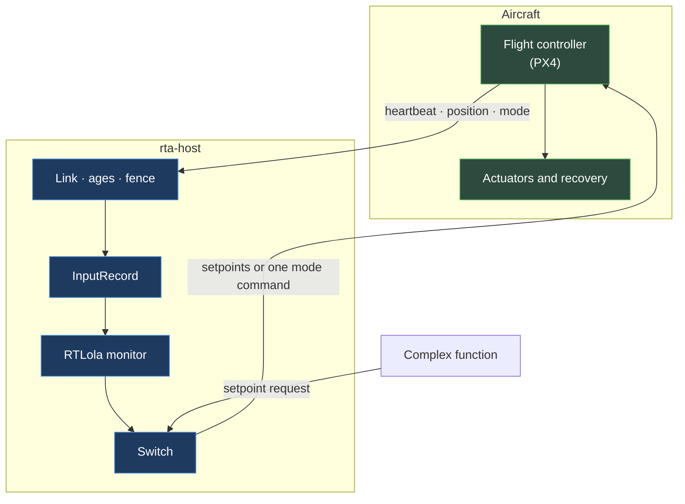
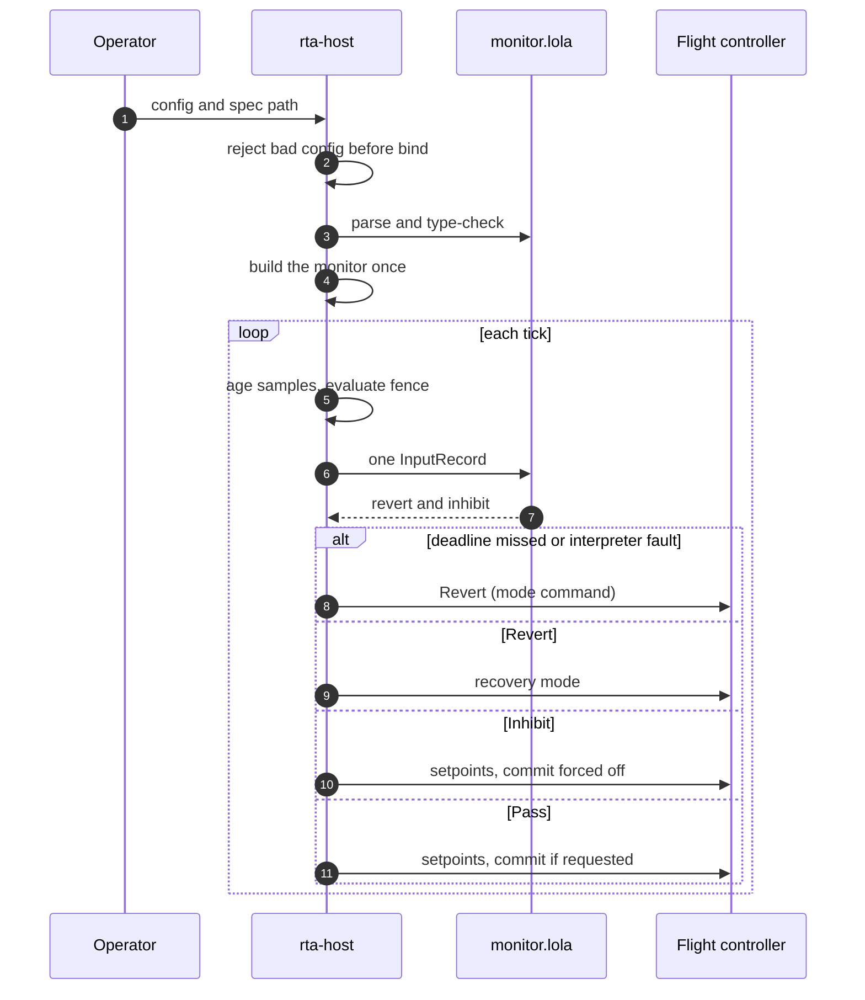
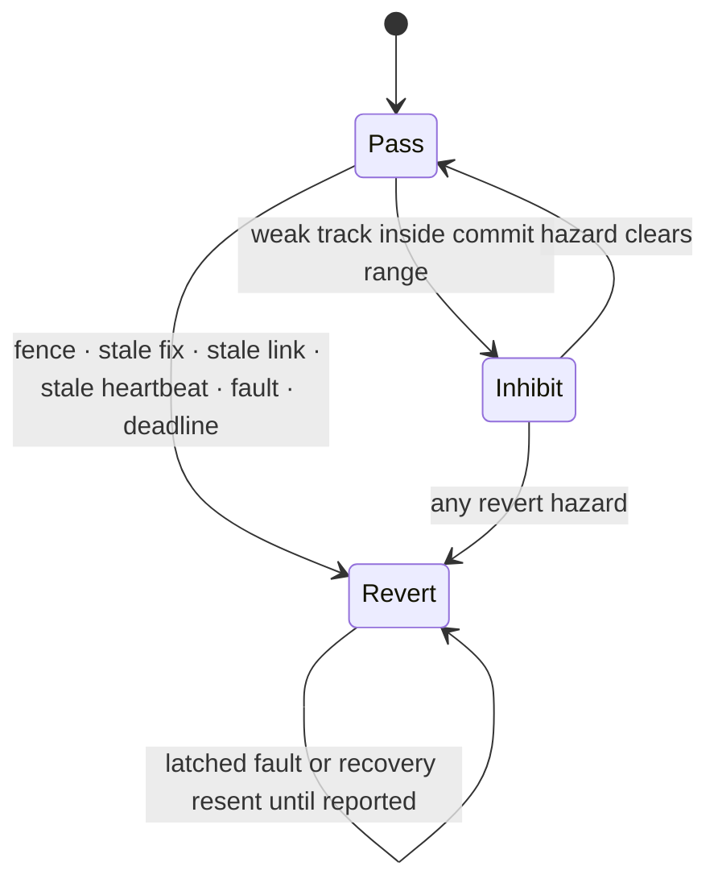
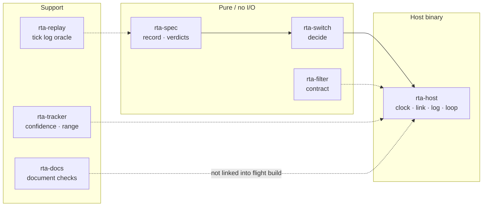
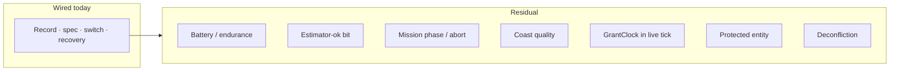

# AuToBoTs

[](https://github.com/MatthewK84/AuToBoTs/actions/workflows/ci.yml)
[](https://github.com/MatthewK84/AuToBoTs/actions/workflows/kani.yml)


**Fail-closed runtime assurance for Group 1–3 small unmanned aircraft.**

The flight controller owns the actuators and the recovery mode. A Rust host owns the clock, the link, and the switch. An RTLola specification owns every predicate. The complex function never reaches the socket.

This repository bounds flight and commit. It does not assure a tactical decision. It is not an authorizing-official package. It does not implement a weapon, a fuze, or a release actuator.

---

## Architecture



The complex function may ask for a setpoint and a commit bit. It cannot send that request. `switch::decide` is the only constructor of an outbound command.

---

## How a tick works



---

## Verdicts

`Revert` beats `Inhibit` beats `Pass`.



| Verdict | What leaves the switch |
| --- | --- |
| **Pass** | Setpoints. Commit only if the request already had it. |
| **Inhibit** | Setpoints. Commit forced off. |
| **Revert** | No setpoints. The recovery mode, resent on a bounded schedule with fallbacks until the flight controller reports it. |

Recovery mode comes from config: `rtl`, `loiter`, or `land`. The switch has no buried default.

---

## Crates



| Crate | Role | Constraint |
| --- | --- | --- |
| `rta-spec` | Input record and verdicts | No sockets |
| `rta-switch` | Pure decision function | No interpreter, no MAVLink |
| `rta-host` | Binary: config, clock, interpreter, link, log, loop | The only crate that binds a socket |
| `rta-filter` | Safety-filter contract | Reshapes a setpoint; never builds a command |
| `rta-tracker` | Frame ingress; reports confidence and range | Host does not decode frames |
| `rta-replay` | Re-evaluates a tick log against the spec | Offline |
| `rta-docs` | Document and source-text checks | Not flight code; no binary links it |

---

## What is on main

The core fail-closed loop is implemented and covered by CI, SITL smoke, and Kani.

| Capability | Location | Status |
| --- | --- | --- |
| Input record | `rta-spec` | Rejects non-finite values |
| Stale samples | `rta-host` | Host ages; spec decides |
| Fence | `rta-host/src/fence.rs` | Trips on the stopping-distance margin |
| Monitor | `spec/monitor.lola` | Thresholds live here, not in Rust |
| Tick | `rta-host/src/eval.rs` | One record, one `accept_event` |
| Deadline | `rta-host/src/eval_worker.rs` | Preemptive: late or hung evaluation reverts and latches |
| Switch | `rta-switch` | Setpoints or mode, never both |
| Link | `rta-host/src/link.rs` | UDP binds. Serial is not built. |
| Runtime loop | `rta-host/src/runtime.rs` | Tick, receive, and watchdog threads |
| Startup gate | `rta-host/src/gate.rs` | Monitor only while disarmed; arm before ready latches |
| Recovery | `rta-host/src/recovery.rs` | Resent until the flight controller reports the mode |
| Command out | `rta-host/src/command_out.rs` | PX4 AUTO sub-modes; setpoints are position and yaw |
| Panics | `docs/panics.md` | Denied outside tests; release build aborts |
| Document checks | `rta-docs` | Run by `cargo test --workspace` |
| CI | `.github/workflows` | Pinned actions, release, aarch64, SITL, fuzz smoke, Kani |
| Evidence hook | `scripts/evidence.sh` | SBOM and provenance required on tags |

---

## Residuals

These paths have scaffolding or documentation on `main`. They are not yet driven by live flight-controller or sensor inputs. The issue list is closed; the residuals below remain in the code.



| Residual | Current behavior | Next step |
| --- | --- | --- |
| Energy to rally | Host publishes a large default endurance | Decode the flight-controller battery message; missing sample becomes 0 |
| Estimator health | `estimator_ok` defaults to `true` | Map the FC fail / innovation flag |
| Mission phase / abort / coast | Hooks exist with safe defaults | Wire the operator / mission path |
| Grant window | `GrantClock` exists and is unit-tested | Wire into the live tick path |
| Protected entity / deconfliction | Documented only | Sensor inputs |
| Log schema | Test rejects grant body and frame | Enforce versioned schema in the writer |

See [docs/known-problems.md](docs/known-problems.md) and [docs/hazards.md](docs/hazards.md).

---

## Build and test

Rust **1.98.1**, rustfmt, and clippy are pinned in `rust-toolchain.toml`.

```sh
cargo test --locked --workspace
cargo clippy --locked --workspace --all-targets -- -D warnings
cargo deny check
cargo kani -p rta-switch
```

SITL against the stand-in peer:

```sh
bash scripts/sitl.sh
bash scripts/sitl-trips.sh
```

PX4 SITL (headless, SIH quadrotor) is the `px4-sitl` CI job. See [docs/sitl.md](docs/sitl.md).

---

## Documentation

| Topic | File |
| --- | --- |
| Hazards and verdicts | [docs/hazards.md](docs/hazards.md) |
| Known problems (operator language) | [docs/known-problems.md](docs/known-problems.md) |
| Tick log format and forbidden fields | [docs/log-format.md](docs/log-format.md) |
| Reason codes | [docs/reason-codes.md](docs/reason-codes.md) |
| Recovery | [docs/recovery.md](docs/recovery.md) |
| Deadline and timing | [docs/deadline.md](docs/deadline.md) |
| CI jobs | [docs/ci.md](docs/ci.md) |
| SBOM | [docs/sbom.md](docs/sbom.md) |
| Build provenance | [docs/provenance.md](docs/provenance.md) |
| Test evidence (DT&E only) | [docs/test-evidence.md](docs/test-evidence.md) |
| Review and AI accountability | [docs/review.md](docs/review.md) |
| Standards binding (DoDD 3000.09 / DoWI 8430.01) | [docs/standards-3000-09-8430-01.md](docs/standards-3000-09-8430-01.md) |
| Assumptions, constraints, open items | [docs/assumptions.md](docs/assumptions.md), [docs/constraints.md](docs/constraints.md), [docs/open-items.md](docs/open-items.md) |
| Engineering tasks | [docs/engineering-tasks.md](docs/engineering-tasks.md) |
| Runbook | [docs/runbook.md](docs/runbook.md) |

---

## Safety properties

- Any fault maps to `Revert`: late tick, interpreter error, missing verdict, NaN input, dead heartbeat, log write failure in flight.
- A latched interpreter fault clears only on process restart.
- Recovery is a mode the flight controller already honors. Config chooses which. Code does not.
- The complex function cannot reach the MAVLink socket. It submits a request. The switch disposes of it.
- Thresholds live in `spec/monitor.lola`. The host has no numeric threshold constants.
- Setpoints and a mode change cannot leave in the same tick. The switch type forbids it.
- SITL and replay are developmental evidence. They are not operational test.

---

## Non-claims

This repository does not implement a weapon, a fuze, or a release actuator.  
SITL is not operational test.  
A wrong-but-fresh position estimate remains a residual.  
No sentence in this packet claims that the repository meets DoDD 3000.09 or DoWI 8430.01.

---

## License and status

Developmental. Every crate is `0.1.0`. No version has been tagged. See [CHANGELOG.md](CHANGELOG.md).
