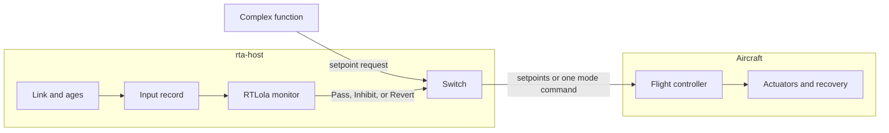
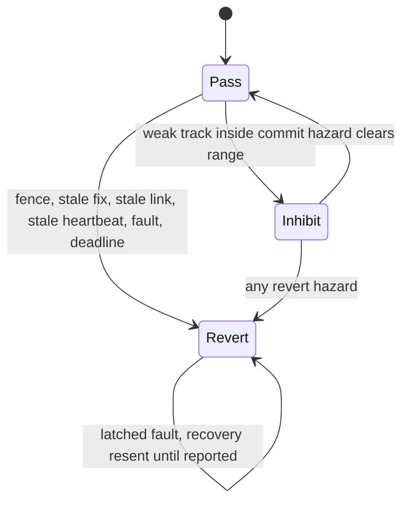
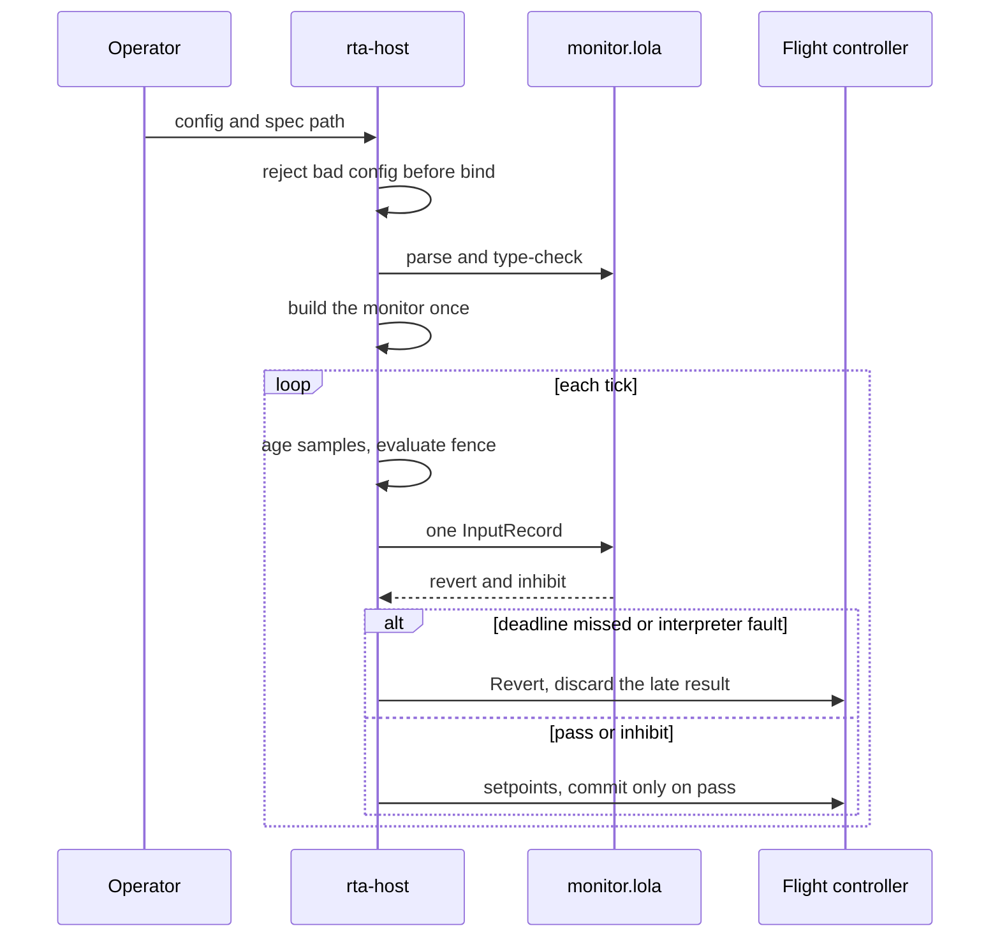
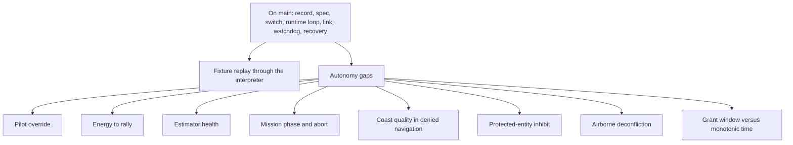

# AuToBoTs

Fail-closed runtime assurance for Group 1–3 aircraft. The flight controller owns the actuators and the recovery mode. A Rust host owns the clock, the link, and the switch. An RTLola specification owns every predicate. The complex function never reaches the socket.

This repository bounds flight and commit. It does not assure a tactical decision. It is not an authorizing-official package. It does not implement a weapon, a fuze, or a release actuator.

## How a tick works



The complex function may ask for a setpoint and a commit bit. It cannot send that request. `switch::decide` is the only constructor of an outbound command.

## Verdicts

`Revert` beats `Inhibit` beats `Pass`.



| Verdict | What leaves the switch |
| --- | --- |
| Pass | Setpoints. Commit only if the request already had it. |
| Inhibit | Setpoints. Commit forced off. |
| Revert | No setpoints. The recovery mode, resent on a bounded schedule with fallbacks until the flight controller reports it (`docs/recovery.md`). |

Recovery mode comes from config: `rtl`, `loiter`, or `land`. The switch has no buried default.

## Workflow



A spec change is a process restart and a golden-trace review. There is no hot reload.

## What the tree does

| Piece | Where | State |
| --- | --- | --- |
| Workspace, pins, config | `Cargo.toml`, `docs/dependencies.md`, `config/example.toml` | On main |
| Hazard list and verdict map | `docs/hazards.md`, `docs/verdicts.md` | On main |
| Timing budget | `docs/timing.md` | On main |
| Input record | `rta-spec` | Rejects non-finite values |
| Stale samples | `rta-host` | Host ages, spec decides |
| Fence | `rta-host/src/fence.rs` | Trips on the stopping-distance margin |
| Monitor | `spec/monitor.lola` | Thresholds live here, not in Rust |
| Tick | `rta-host/src/eval.rs` | One record, one `accept_event` |
| Deadline | `rta-host/src/eval_worker.rs`, `docs/deadline.md` | Preemptive: evaluation on a worker thread; a late or hung evaluation reverts within one deadline and latches |
| Switch | `rta-switch` | Setpoints or mode, never both |
| Link | `rta-host/src/link.rs` | UDP binds. Serial is not built. |
| Runtime loop | `rta-host/src/runtime.rs`, `docs/runtime.md` | Tick, receive, and watchdog threads. Tested against a fake flight controller, not PX4 SITL. |
| Startup gate | `rta-host/src/gate.rs`, `docs/startup.md` | Monitor only while disarmed; arm before ready latches `not_ready_at_arm` |
| Recovery | `rta-host/src/recovery.rs`, `docs/recovery.md` | Resent until the flight controller reports the mode; RTL and land fallbacks; `COMMAND_ACK` read |
| Command out | `rta-host/src/command_out.rs`, `docs/icd-fc.md` | PX4 AUTO sub-modes; setpoints are position and yaw to the heard flight controller |
| Per-tick memory | `docs/runtime.md` | No allocation on the tick thread in steady state; the tick log stays byte-identical |
| Panics | `docs/panics.md` | Denied in host code outside tests; a release build aborts and the flight controller's failsafe takes over |
| Document checks | `rta-docs`, `docs/doc-checks.md` | Not linked into a flight build; run by `cargo test --workspace` |
| CI | `.github/workflows`, `docs/ci.md` | Pinned actions, read-only tokens, release, aarch64, SITL stand-in, fuzz smoke |
| Evidence | `scripts/evidence.sh` | SBOM and provenance hook |

## Missing features

These are not on `main`. The issues stay open until the acceptance tests exist.



| Feature | Why it is missing | Issue |
| --- | --- | --- |
| Fixture replay | `spec/fixtures/verdicts.json` is not yet run through the interpreter. | M7.3 |
| Pilot override | A stick, a mode change, or RC takeover must beat the companion in the same tick. | [#179](https://github.com/MatthewK84/AuToBoTs/issues/179) |
| Energy to rally | Revert while the rally is still reachable, not after it is not. | [#180](https://github.com/MatthewK84/AuToBoTs/issues/180) |
| Estimator health | A fresh wrong position is only an age today. | [#181](https://github.com/MatthewK84/AuToBoTs/issues/181) |
| Mission phase | Search, track, commit, and abort are not states the monitor can see. | [#182](https://github.com/MatthewK84/AuToBoTs/issues/182) |
| Abort of a sent commit | Withdraw stops the next tick. The command already on the wire has no cancel. | [#183](https://github.com/MatthewK84/AuToBoTs/issues/183) |
| Denied navigation | No coast-quality or inertial-only input. | [#184](https://github.com/MatthewK84/AuToBoTs/issues/184) |
| Protected-entity inhibit | No no-strike list and no second-track miss. | [#185](https://github.com/MatthewK84/AuToBoTs/issues/185) |
| Airborne deconfliction | Nothing looks at another aircraft. | [#186](https://github.com/MatthewK84/AuToBoTs/issues/186) |
| Grant time | The tick clock is monotonic. A grant window is wall time. | [#187](https://github.com/MatthewK84/AuToBoTs/issues/187) |
| Evidence pack | SBOM, provenance, log redaction, and the human-accountability line are hooked, not a compliance claim. | [#188](https://github.com/MatthewK84/AuToBoTs/issues/188) |


## Crates

- `rta-spec` holds the input record and the verdicts. No sockets.
- `rta-switch` is a pure function. No interpreter and no MAVLink.
- `rta-host` is the binary. Config, clock, interpreter, link, and log.
- `rta-filter` is the safety-filter contract. It reshapes a setpoint and never builds a command.
- `rta-tracker` owns frame ingress and reports confidence and range. The host does not decode.
- `rta-replay` re-evaluates a tick log against the spec.
- `rta-docs` holds the document and source-text checks. Not flight code; no binary links it (`docs/doc-checks.md`).

## Build

Rust 1.98.1, rustfmt, and clippy are pinned in `rust-toolchain.toml`.

```sh
cargo test --workspace
cargo clippy --workspace --all-targets -- -D warnings
cargo deny check
./scripts/wait-ci.sh
```

`scripts/wait-ci.sh` blocks until the push run for this commit finishes. It exits non-zero if CI fails.

The full list of checks, and how changes are made here, is in `CONTRIBUTING.md`. Changes are listed in `CHANGELOG.md`.

## License

Apache License, Version 2.0. See `LICENSE`.

`scripts/close-issue.sh 24` runs that wait, then closes the issue. A commit that contains `Issue: 24` is closed by CI after compile, deny, and evidence pass. A commit with no issue line closes nothing.


The example config is `config/example.toml`. A missing or invalid file exits before a socket. The predicate source is `spec/monitor.lola`.

## Read next

- [Hazards](docs/hazards.md)
- [Verdicts](docs/verdicts.md)
- [Timing](docs/timing.md)
- [Spec notes](docs/spec-notes.md)
- [Fence](docs/fence.md)
- [Interface](docs/icd.md)
- [Standards gate](docs/standards-3000-09-8430-01.md)
- [Task list](docs/engineering-tasks.md)
